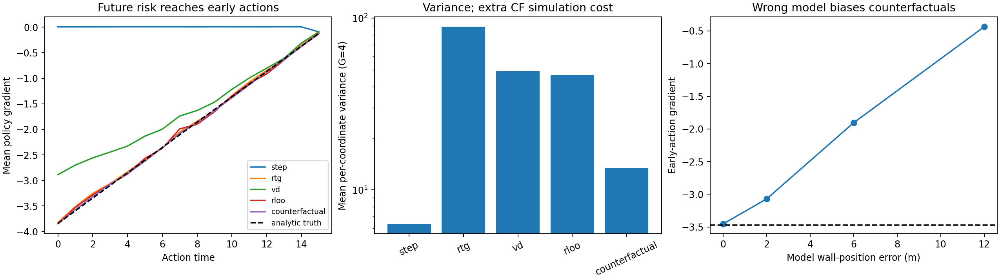
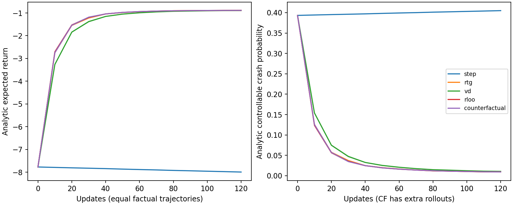
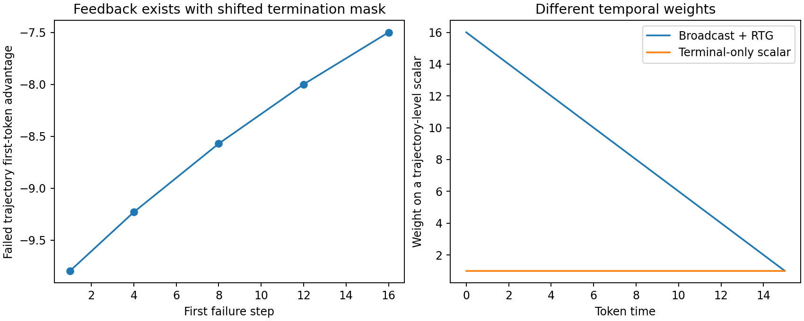

# 最小 CPU 实验：执行结果与解释

执行报告日期：2026-10-20（Asia/Shanghai）。所有数值由随附 `toy_experiment.py` 实际运行生成；CSV/JSON 为原始结果，未手工补写样本。**这是机制检验，不是 Plan-R1 基准复现。**

## 1. 复现命令与运行范围

在已配置的 CPU 环境：

```bash
source /workspace/.planr1/activate.sh
python /workspace/research/toy_experiment.py \
  --out /workspace/research/results \
  --source-root /workspace/Plan-R1
```

可移植的 toy 仅需 Python≥3.9、numpy、matplotlib；不使用 `--source-root` 就不执行 Plan-R1 源码审计。源码审计还需要已配置的 torch、torch_geometric、torch_scatter 等源码依赖。默认 seeds=8、groups=4096、iterations=120。CPU 完整运行本次约 8.17 秒，包含绘图与源码审计；时间只描述当前机器，非计算效率比较结论。

实际版本：Python 3.9.25，numpy 1.24.4，matplotlib 3.9.4，torch 2.1.0+cpu。源码 SHA `23bc54433599002f275c18b88cf261ab5e87d775`。脚本 SHA256 `563143d72f52cd7542420ca1d9830622b72a7bb4cc813002f5f4b8577c4272f4`；最终脚本摘要也记录于 `results/summary.json`。

## 2. 连续运动与目标：为什么可以算出真实梯度

16 个动作，每步 0.5s，初速度 8m/s。动作是连续加速度：a_t~N(μ_t,0.8²)，策略均值按时间独立参数化。

```text
x_(t+1) = x_t + v_t·dt + 0.5·a_t·dt²
v_(t+1) = v_t + a_t·dt
r_t = 0.05·(x_(t+1)-x_t) - 0.01·a_t²
r_(H-1) -= 20·1[x_H >= 66] + 20·Z
Z ~ Bernoulli(0.15)，与动作无关，同组共享。
```

终点事件表示“延迟才被评价的风险”；主实验固定时长、不在中途终止。它使用负终点罚分，**没有照抄 Plan-R1 的非负安全门控奖励**。这样能清楚隔离延迟信用与无关随机性。代码还单独审计原实现的安全门控、终止、广播，避免把两个实验混为一谈。

这个线性机制模型允许负速度、无界 Gaussian 动作；不是符合车辆动力学约束的驾驶仿真。选择开放环策略是为了使固定后续动作的反事实 baseline 有明确动作独立性。真实 reactive policy 在改动一个动作后，必须重新生成后续 policy/周车动作。

令 w_t=dt²(H−t−1/2)，则 x_H~N(64+w·μ, 0.8²||w||²)。因此

```text
J(μ) = 0.05·(64+w·μ) - 0.01·Σ(μ_t²+0.8²)
       -20·P(x_H>=66) -20·0.15
∂J/∂μ_t = 0.05·w_t -0.02·μ_t -20·φ(z)·w_t/(0.8||w||)
```

z 是 Gaussian 标准化风险边界。本次解析梯度与解析期望目标的中心有限差分最大误差为 **4.25e-10**。无需用高噪声 Monte Carlo 梯度自己充当 ground truth。

## 3. 比较的估计量及公平性

所有方法使用同一目标、同一 Gaussian policy、相同事实动作噪声和环境噪声；score 为 (a_t−μ_t)/0.8²。

| 方法 | 乘在 score 上的权重 |
|---|---|
| step | r_t；故意保留只看即时奖励的弱基线 |
| rtg | Σ_(u≥t) r_u |
| vd | Σ_(u≥t)(r_u−μ_group)，μ_group 在同组 G×H 全时间上计算 |
| rloo | RTG_g,t 减去其他 G−1 条 RTG 的均值 |
| counterfactual | 事实总回报减去替换 a_t 后 K=8 个独立策略动作的平均总回报；保持其他动作和环境 Z 相同 |

VD 的主比较用 c=1 对齐 reward 单位。原配置 c=.1 的优势是其 10 倍，方差为其 100 倍；若不调整学习率/KL 强度，就不是只比较估计机制。源码审计使用原 c=.1，不把主 toy 的缩放设置冒充原配置。

反事实每条事实轨迹额外评估 H×K=128 个候选结果。线性动力学允许精确代数更新终点与奖励，代码实际使用这个加速，**没有真的运行128条完整物理 rollout**。CSV 的 `rollout_equivalents` 是“若逐条评估候选，需要的候选结果数”，不是 GPU/FLOPs/真实 wall-clock；不能用它声称测得129倍时间开销或等算力优势。所有替代动作的采样和结果都被实际计算。

反事实 baseline 的无偏条件在本 toy 中成立：给定外生噪声和其余独立动作，替代结果不依赖事实 a_t。把它直接迁移到自回归或反应性环境并固定所有未来动作，会改变 estimand，不能沿用该结论。

## 4. 固定策略梯度测量

8 个 seeds，每 seed 4096 组、G=4，共131,072条事实轨迹；方法共享这些事实数据。均值和 CI 在 seed 层计算；CI 是8个 seed 均值的近似 t 区间，不是每个场景、每个时刻的保证。方差是每个 G=4 组的梯度估计在组间的样本方差，再对16个坐标和seed平均。

真实前4步平均梯度 = **-3.469610**。

| 方法 | 前4步平均梯度（均值 ± 95% CI） | 坐标平均方差（G=4） | 梯度均值 RMSE |
|---|---:|---:|---:|
| 普通逐步奖励 | 0.0052 ± 0.0005 | 6.3492 | 2.2934 |
| Return-to-go | -3.4123 ± 0.0242 | 89.1080 | 0.1403 |
| VD 风格累计优势 | -2.6472 ± 0.0086 | 49.1772 | 0.4885 |
| RTG + RLOO | -3.4327 ± 0.0135 | 46.8219 | 0.1064 |
| 配对反事实 | -3.4518 ± 0.0496 | 13.4834 | 0.0629 |




可以支持：step 在早期只收到很小的进度信号，方向与应对终点风险所需的梯度相反；RTG 和 VD 都能传回负风险信号。VD 不是“看不到未来”，它的中心估计会改变梯度尺度。RLOO 是重要对照，说明改善不一定需要新反事实算法。配对反事实在这组已知模型与共同随机性条件下把平均坐标方差从 RTG 的89.108降到13.483、从RLOO的46.822降到13.483。

不能支持：反事实对所有任务都降低方差；更低方差一定改善最终 policy；此数值差等同于真实 Plan-R1 缺陷。step 方差更低也不能说明更好，因为其估计目标缺少早期延迟风险。

## 5. 小策略学习结果

每更新64组×4事实轨迹，统一有效学习率0.01、策略均值截断到[−1.5,1.5]，120次更新、8个 seeds。没有分别为某个方法调参。评价使用上述**解析期望值和解析碰撞概率**，不是另造一份测试数据或选择最佳seed。

| 方法 | 最终期望 return | 可控碰撞概率（% ± CI） | 事实轨迹数/seed | 候选结果评估数/seed |
|---|---:|---:|---:|---:|
| 普通逐步奖励 | -7.9902 | 40.493 ± 0.081 | 30,720 | 30,720 |
| Return-to-go | -0.8871 | 0.935 ± 0.105 | 30,720 | 30,720 |
| VD 风格累计优势 | -0.8935 | 1.076 ± 0.061 | 30,720 | 30,720 |
| RTG + RLOO | -0.8868 | 0.955 ± 0.047 | 30,720 | 30,720 |
| 配对反事实 | -0.8859 | 0.939 ± 0.037 | 30,720 | 3,962,880 |




RTG、VD、RLOO、反事实都达到约1%的可控风险；反事实最终风险并未明显优于RTG，且候选计算更多。这是本次最重要的反向证据：**不能仅凭方差图就宣称需要替换 VD 或有强论文收益。** 全部方法的 expected return 仍包含无法由动作改变的外生损失，因而约−0.89的值不代表可控事件仍很多。

这是等事实数据/更新数的比较，**不是等总模型调用预算比较**。后续若评估计算效率，必须把branch次数、后缀长度、缓存复用和真实时间纳入，并让便宜基线使用省下的预算；本次未声称已证明这种效率收益。

## 6. 模型误差可以摧毁更精细的归因

只把反事实评估器中的风险边界错设为 66+shift，真实目标仍是边界66；事实和替代 risk 都按这个错误模型计算。

| 模型中的墙位置误差 | 前4步平均梯度 | 相对真实梯度的均值 RMSE |
|---|---:|---:|
| +0 m | -3.4518 | 0.0629 |
| +2 m | -3.0700 | 0.2648 |
| +6 m | -1.9040 | 1.0305 |
| +12 m | -0.4367 | 2.0005 |


同样的反事实公式，在错误模型中给出明显偏离真实目标的梯度。因此“归因更细”不能代替“世界模型判断更对”。该 ablation 只检验已知边界误差，没有学习世界模型，不代表 Plan-R1 存在相同幅度的误差。

## 7. 真实源码方法执行：与主 toy 分开

`source_audit` 从固定SHA的源码 AST 提取并执行 `compute_ae_process_supervision`、`reward_fn`、`training_step`，以控制张量替代依赖；另直接运行原 `ProgressReward`、`SpeedLimitReward`。没有构建完整模型、加载 token 权重或真实场景。结果保存在 `results/source_audit.json`。

1. 实际优势函数与独立numpy反向求和结果一致；失败轨迹 `[1,1,0,0]` 的第一token优势约−8，证实早期风险反馈存在。
2. 原reward_fn 的首次失败当步掩码为真、下一步才屏蔽：`[true,true,true,false]`。raw reward 后续可以恢复为1，但会被优势/损失掩码屏蔽。
3. 四条相同时间曲线 `[1,1,1,0]` 的第一token累计中心化优势为0；不能因此说全部时刻优势都为0。
4. 枚举2^4个Bernoulli组样本：实际方法期望梯度 **0.1875**，真实梯度 **0.25**；验证受限条件下自包含组均值缩放效应。它不是完整Plan-R1 PG的无偏性测试。
5. 实际training_step 的ratio前向虽为1，反传的参数梯度仍非零；不能把这段代码误判成“训练没有policy gradient”。
6. 真实progress/speed类的直线路线fixture：首次失败token设为索引2，只改索引3及其后状态。progress从 **1.0** 变成 **0.1875**，speed均为1；其余soft分量固定1时，有效前缀reward从 **1.0** 变为 **0.91875**。计算该前缀分数组合时使用与原reward_fn相同的2/5/2/1权重；没有声称执行了真实碰撞几何或自动判定fixture事故。



`termination.csv` 将一条失败轨迹与三条存活轨迹组队，原风格中心化后，在失败步1/4/8/12/16时，失败轨迹首步优势分别约−9.796/−9.231/−8.571/−8/−7.5。反馈始终存在。`broadcast_weights.csv` 展示全轨迹分数复制到每步再RTG，会产生16到1的时间权重，terminal-only则每步为1。

## 8. 可复现性与适用边界

脚本固定全部seed；原始CSV、JSON、PNG/SVG随附。完整重复执行后的逐文件一致性检查记录在 `results/reproducibility.json`。时间字段和平台字段可以随机器改变，数值结果应在相同版本和配置下复现。

主要限制：单维线性连续运动；固定初始速度；单一延迟终点事件；人工外生风险；开放环Gaussian策略；只测一个主配置；无KL正则、top-k采样或学习的世界模型；没有车辆形状、交互、地图、感知误差和receding-horizon执行。真实源码审计仅覆盖受控计算路径。这些限制使实验适合辨认机制，不足以评估任何真实驾驶规划器。
