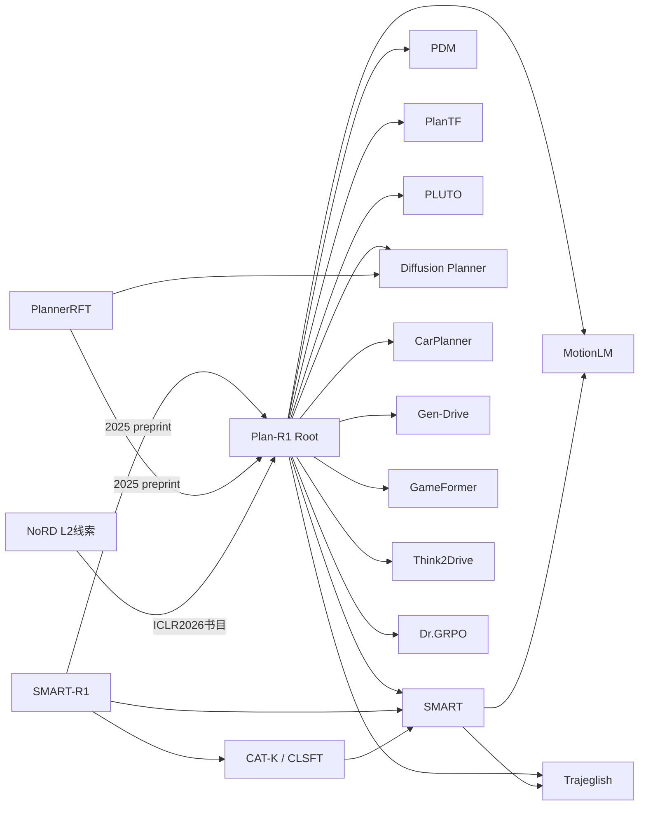

# 问题驱动的技术分类

本树允许一篇论文进入多分支。`Q/M/A/L/B` 的精确定义与连接见 [nodes.csv](nodes.csv)、[methods.csv](methods.csv)。下面是问题与机制视图，不是按年份构造的继承链。

```text
Plan-R1：安全且可行的语言模型式规划
├─ Q01 联合未来与多模态表达
│  ├─ 离散AR：MotionLM / Trajeglish / SMART / Plan-R1
│  │  ├─ 同刻条件独立：MotionLM、Plan-R1
│  │  └─ 同刻顺序条件化：Trajeglish
│  ├─ 一致模式的连续AR：CarPlanner
│  ├─ 联合扩散：Diffusion Planner / Gen-Drive / PlannerRFT
│  └─ 层级交互推理：GameFormer
├─ Q02 开环到闭环的状态分布偏移
│  ├─ 扰动、重归一化、状态dropout：PlanTF
│  ├─ 对比场景增强和辅助loss：PLUTO
│  └─ 策略支持内的监督恢复：CAT-K → SMART-R1的SFT阶段
├─ Q03 如何显式施加安全原则
│  ├─ 规则提案/选择：PDM、PLUTO；优化修正：GameFormer
│  ├─ 可微生成引导：Diffusion Planner
│  ├─ 学习偏好奖励+RL：Gen-Drive
│  └─ 规则门控奖励+RL：Plan-R1
├─ Q04 奖励与优化器是否保留目标权重
│  ├─ GRPO的std/长度偏差：Dr.GRPO（文本域）
│  ├─ 跨组尺度/安全优先级：Plan-R1 VD-GRPO
│  └─ 固定阈值的metric对齐：SMART-R1 MPO（模拟域）
├─ Q05 有效探索与同奖组
│  ├─ 一致mode及专家距离引导：CarPlanner
│  ├─ 场景适配探索：PlannerRFT的PPO分支
│  └─ survival信号：PlannerRFT的GRPO分支
├─ Q06 规划结果与执行轨迹不一致
│  ├─ 显式诊断与RL Adapter：PlanTF
│  ├─ 在执行仿真中训练探索：PlannerRFT
│  └─ 作为Root尚待拆解的误差来源（分析判断）
├─ Q07 交互反应与世界模型有效性
│  ├─ 时间因果预测：MotionLM、Trajeglish
│  ├─ 冻结NTP他车模型：Plan-R1
│  ├─ 非反应一次性预测：CarPlanner（效率取舍）
│  └─ RSSM潜模型+控制策略：Think2Drive（CARLA协议）
└─ Q08 泛化、规模与后训练遗忘
   ├─ 跨数据域/规模：SMART、Trajeglish
   ├─ reward exploitation：Gen-Drive
   └─ 分布恢复/难例比例：SMART-R1、PlannerRFT
```

## 只画已核引用的根邻域

箭头为 **引用者 → 被引者**，包括对预印本的引用。图省略许多边；完整42条在references.csv。视觉上相邻不表示方法继承。



## 机制上的继承与互补

| 关系 | 证据 | 判定 |
|---|---|---|
| Root EXTENDS Dr.GRPO | Root §2.2明确说明启发来源 | 已核作者陈述；不能把去std本身重复认领 |
| Root EXTENDS SMART | Root §3.2引用的分解注意力/NTP | 已核组件级继承；不声称继承全部RoadNet任务 |
| CAT-K EXTENDS SMART | CAT-K §5.1 | 已核架构选择 |
| SMART-R1 EXTENDS SMART、CAT-K | §3.1–3.4、§4.1 | 已核实现路线 |
| PlannerRFT EXTENDS Diffusion Planner | §5.1 | 已核预训练骨干来源 |
| Root + CAT-K / SMART-R1 / survival / Adapter / consistent-mode | 双方方法解决不同瓶颈 | 仅假说，见combinations；并非已成立创新 |

本批安全分支覆盖训练目标、生成引导、候选选择和执行修正，**未系统覆盖CBF、可达性或形式验证**。不能把经验reward门控与那些保证混为一谈；未来若要研究形式约束，先补读第二层文献并核对可组合假设。
