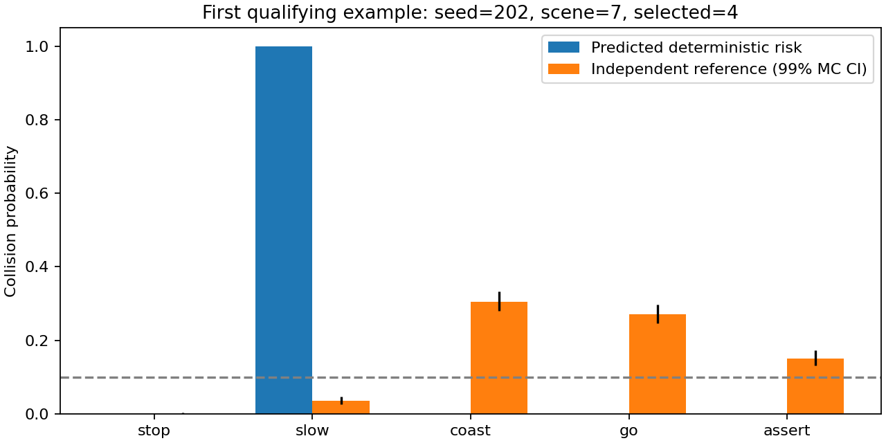
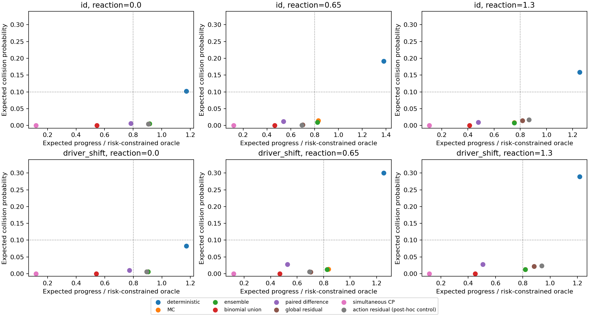
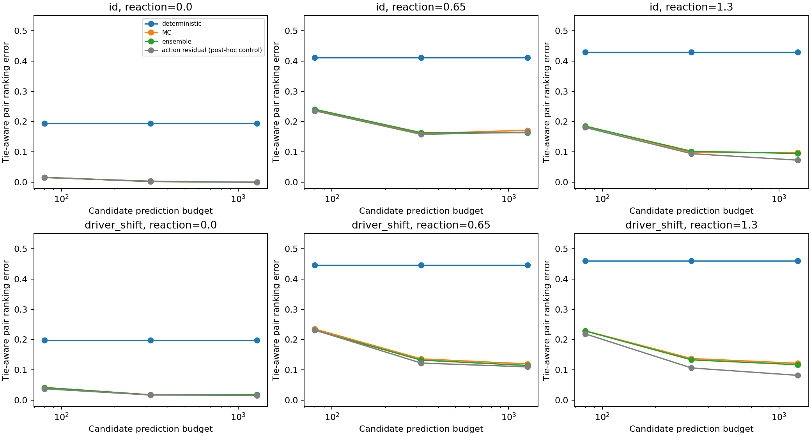
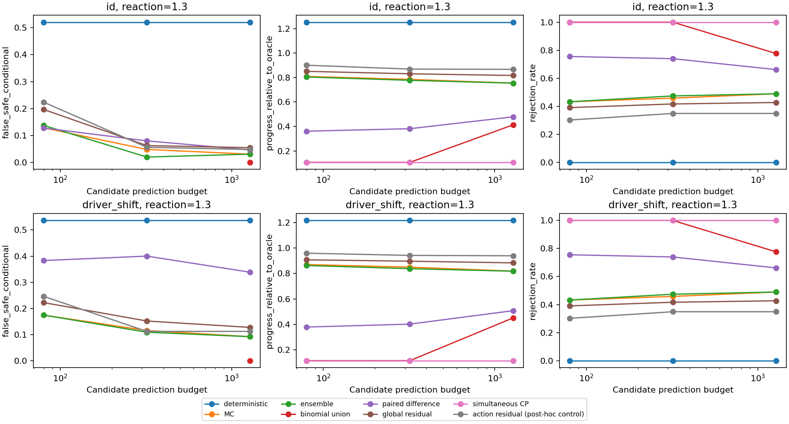

# 第二阶段实际实验结果

结论：toy 中存在预测排序与参考风险不一致，但**目前不支持以新的风险排序算法直接立项**。普通多样本/ensemble 消除大部分确定性基线的危险选择；剩余问题需分开检查绝对风险低估、保守性与隐藏行为漂移。没有运行 Plan-R1 真实模型，不能据此评价其基准安全性。

## 设计与数据完整性

主方案见 `protocol.json`，在主结果产生前固定；四种子、三档反应、两域、三个预算、9个原始方法，31104条决策。随后保留原始文件，增加2个按动作校准的普通控制（6912条决策），见 `baseline_extension.json`。补充是在看到全局 CP 全停车后决定的，不是预注册验证；没有用 test 标签拟合校准参数或调超参。完整数据共38016条决策、5760条参考候选记录，CSV均可追溯场景与种子。

机制测试通过；对全部38016条记录检查风险、接受、进度、部署结果和预算一致性；额外重放一个48场景参考块及27个原始方法/预算组合，计数、进度、预测和选择**逐项精确一致**，见 `results/verification.json`。这是一个块的复现，不冒充全矩阵二次复现。

## 1. 强反应、B=1280：所有方法

每表192场景。排序错率*为严格逆序+半个平局，必须结合下文的分解；NA=全部停车、条件错误率未定义。调用数和CPU秒为该表行的192场景合计在线成本，离线成本另列。所有强度、两域、全部11方法的B=1280表见 [full_budget_table.md](full_budget_table.md)，其他预算及95%区间见 [all_methods_summary.csv](results/all_methods_summary.csv)。

### ID

| 方法 | 排序错率* | 错误接受/已接受 | 部署碰撞 | 期望碰撞 | 部署进度m | 进度/参考规则 | 停车 | 调用数 | CPU秒 |
|---|---:|---:|---:|---:|---:|---:|---:|---:|---:|
| deterministic | 42.93% | 52.08% | 14.58% | 15.91% | 74.13 | 125.31% | 0.00% | 960 | 0.0035 |
| mc | 9.79% | 3.06% | 0.52% | 0.86% | 44.29 | 75.43% | 48.96% | 245760 | 0.0273 |
| ensemble | 9.50% | 3.06% | 0.52% | 0.81% | 44.26 | 75.41% | 48.96% | 245760 | 0.0263 |
| binomial_union | 9.50% | 0.00% | 0.00% | 0.00% | 24.15 | 41.28% | 77.60% | 245760 | 0.0376 |
| paired_difference | 9.00% | 4.62% | 0.52% | 0.97% | 28.15 | 47.84% | 66.15% | 245760 | 0.0293 |
| residual_calibration | 9.50% | 5.45% | 0.52% | 1.47% | 48.23 | 81.67% | 42.71% | 245760 | 0.0252 |
| marginal_cp | 9.50% | NA | 0.00% | 0.00% | 6.19 | 10.58% | 100.00% | 245760 | 0.0253 |
| simultaneous_cp | 9.50% | NA | 0.00% | 0.00% | 6.19 | 10.58% | 100.00% | 245760 | 0.0231 |
| worst_member | 9.50% | 1.20% | 0.52% | 0.26% | 39.58 | 67.85% | 56.77% | 245760 | 0.0265 |
| action_residual | 7.29% | 4.80% | 0.52% | 1.70% | 51.22 | 86.71% | 34.90% | 245760 | 0.0275 |
| actionwise_cp | 9.50% | NA | 0.00% | 0.00% | 6.19 | 10.58% | 100.00% | 245760 | 0.0229 |

### 隐藏驾驶人漂移

| 方法 | 排序错率* | 错误接受/已接受 | 部署碰撞 | 期望碰撞 | 部署进度m | 进度/参考规则 | 停车 | 调用数 | CPU秒 |
|---|---:|---:|---:|---:|---:|---:|---:|---:|---:|
| deterministic | 46.01% | 53.65% | 26.56% | 28.94% | 66.62 | 121.59% | 0.00% | 960 | 0.0032 |
| mc | 12.20% | 9.18% | 1.04% | 1.29% | 43.97 | 81.82% | 48.96% | 245760 | 0.0251 |
| ensemble | 11.73% | 9.18% | 1.04% | 1.28% | 43.93 | 81.76% | 48.96% | 245760 | 0.0261 |
| binomial_union | 11.73% | 0.00% | 0.00% | 0.01% | 24.15 | 45.10% | 77.60% | 245760 | 0.0357 |
| paired_difference | 10.18% | 33.85% | 4.17% | 2.75% | 26.57 | 50.78% | 66.15% | 245760 | 0.0284 |
| residual_calibration | 11.96% | 12.73% | 2.60% | 2.16% | 47.18 | 88.30% | 42.71% | 245760 | 0.0252 |
| marginal_cp | 11.73% | NA | 0.00% | 0.00% | 6.19 | 11.56% | 100.00% | 245760 | 0.0241 |
| simultaneous_cp | 11.73% | NA | 0.00% | 0.00% | 6.19 | 11.56% | 100.00% | 245760 | 0.0235 |
| worst_member | 11.73% | 7.23% | 1.04% | 0.85% | 39.26 | 73.45% | 56.77% | 245760 | 0.0271 |
| action_residual | 8.21% | 11.20% | 2.60% | 2.32% | 50.18 | 93.85% | 34.90% | 245760 | 0.0220 |
| actionwise_cp | 11.73% | NA | 0.00% | 0.00% | 6.19 | 11.56% | 100.00% | 245760 | 0.0203 |

## 2. 固定预算比较

| 域 | B | ensemble 排序错率 | 错误接受/已接受 | 期望碰撞 | 进度比 | 停车 |
|---|---:|---:|---:|---:|---:|---:|
| id | 80 | 18.50% | 13.76% | 2.30% | 80.44% | 43.23% |
| id | 320 | 10.21% | 1.98% | 0.78% | 77.74% | 47.40% |
| id | 1280 | 9.50% | 3.06% | 0.81% | 75.41% | 48.96% |
| driver_shift | 80 | 22.86% | 17.43% | 3.60% | 86.24% | 43.23% |
| driver_shift | 320 | 13.33% | 10.89% | 1.79% | 83.74% | 47.40% |
| driver_shift | 1280 | 11.73% | 9.18% | 1.28% | 81.76% | 48.96% |

确定性预测每场景只用5次有用调用；其他方法用满B，不以无效重复填充预算。高预算并非每个指标都单调改善；例如ID强反应ensemble在B=320时条件错误接受1.98%，B=1280为3.06%，且进度略下降，不能只选最有利档位。

无反应负对照中，B=1280、ID的MC/ensemble排序错率为0、错误接受0、进度比91.45%；中反应ensemble为4.30%错误接受、82.38%进度比。结构错设与交互会增加困难，但不是所有互动强度都需要新算法。负对照未被隐去。

## 3. 排序、打平与危险选择不是同一个指标

ID强反应700个可区分动作对：deterministic有567平局、17严格逆序，tie-aware错率42.93%；ensemble有3平局、65严格逆序，错率9.50%。**ensemble的严格逆序占比更高，但碰撞更少**：只报告42.93%→9.50%会夸大“纠正逆序”证据。

同条件deterministic有100次错误接受，65次存在安全非停车替代，只有3次所选动作与安全替代严格反排。ensemble只有3次错误接受，全部无安全非停车替代；shift下ensemble的9次也是如此。见 [selection_failure_modes.csv](results/selection_failure_modes.csv)。这些残余失败更直接是没有识别“应当停车”的绝对风险阈值错误。排序可能仍有问题，但没有证明它是强基线剩余碰撞的主要原因。

[example.json](results/example.json)保存按明确规则取到的首个deterministic实例：seed202/scene7，强反应ID。assert预测风险0，参考0.15088；slow预测1，参考0.03564，后者99%参考区间上限0.04757、前者下限0.13110。选择assert且独立部署发生碰撞，说明这种机制**可以**出现；它是说明例，不是挑例后估计频率。

## 4. 便宜方法已经做到什么，还不能断言什么

ID强反应期望碰撞：deterministic15.91%（95%bootstrap区间13.35–18.45%），ensemble0.81%（0.32–1.80%）。ensemble条件错误接受为3/98=3.06%，bootstrap区间0–9.28%，进度比75.41%。这是明显改善，但不能以点估计断言达到严格5%保证。

新增action_residual同条件错误接受6/125=4.8%（0.81–10.25%），进度比86.71%，达到预先经验门槛的**点估计**。它使用普通校准，说明“安全与进度之间一定存在新方法缺口”尚未成立；其区间和事后设计又不足以宣布问题完全解决。需要新场景验证，不能从当前测试集选出最佳方法后包装泛化。

max-over-actions/pooled/actionwise CP本轮全部停车，0碰撞不能视为有效解决；对应进度只有参考规则的约10–12%。这不推翻CP理论：我们尚未做上下文条件化校准，也未满足 interactive robust CP/CPC 的完整假设。模型内binomial筛选更保守，在高预算下仍有约78%停车；paired difference的模型风险差上界也不能修正绝对偏差，shift下其错误接受可达33.85%。这些都不是击败同名完整论文的证据。

隐藏shift下ensemble条件错误接受9.18%、期望碰撞1.28%，预测与ID完全相同。这说明同一个错设模型的自信度不能保证隐藏参数漂移后的安全；不说明存在一个无需任何额外可观测信息/真实反馈就能解决它的方法。

## 5. 数值精度与CPU成本

每条件4个未用于主测试的新场景，dt从0.08减到0.04的平均/最大风险差为0.00102/0.02148；独立8192样本参考与2048样本参考平均/最大差为0.00638/0.03394。见 `numerical_validation.csv/json`。这是有限敏感性检查，不证明精确连续动力学或所有阈值标签正确。

| 阶段 | CPU-only elapsed秒 | 在线模型调用 | 离线模型调用 | 参考调用 |
|---|---:|---:|---:|---:|
| main | 164.306 | 15,500,160 | 1,290,240 | 14,751,360 |
| post_hoc_controls | 22.018 | 3,870,720 | 1,290,240 | 1,966,080 |
| numerical_validation | 15.532 | 0 | 0 | 1,474,560 |
| one_block_replay | 4.958 | 645,840 | 0 | 491,520 |
| total_recorded_components | 206.814 | 20,016,720 | 2,580,480 | 18,683,520 |

时间为真实CPU-only执行的wall time，非OS累计process CPU time；主阶段包含20.432秒bootstrap汇总、日志和checkpoint I/O。上表合计不含早期smoke/单元测试、阅读、图表分析及交付。在线“调用”是候选随机完整结果，不是神经网络forward。可共享的校准/参考也保留原始重复实际调用数，不隐去事后控制的额外成本。

完整定义、校准条件与公平性限制见 [environment_and_metrics.md](environment_and_metrics.md)。最终立项判断及尚缺证据见 [go_no_go.md](go_no_go.md)。本轮没有提供新算法或新定理，也不能支持Plan-R1真实基准存在同类缺陷的结论。
