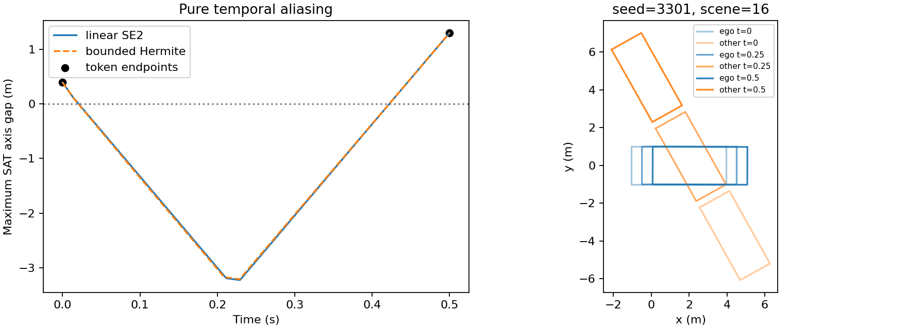
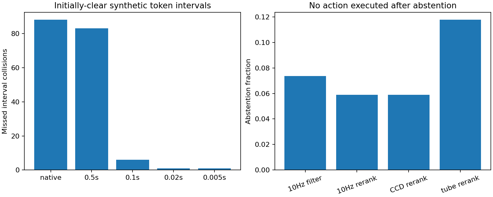
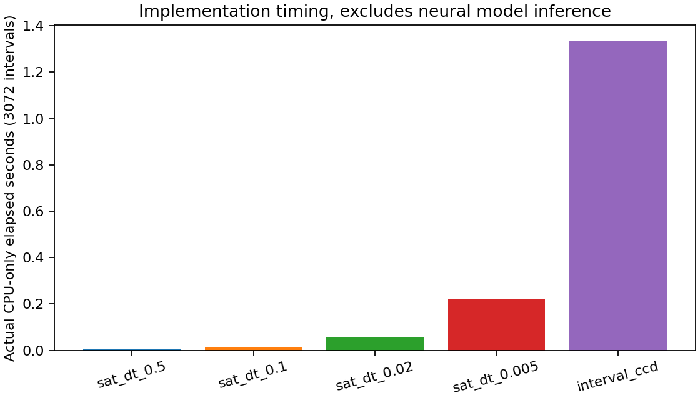

# 第一轮实际执行报告与结果

**结果支持存在端点—区间安全不一致，但尚不支持新方法优于廉价修复。** 无完整模型训练、GPU或大型数据下载；真实模型输出数为0。

## 1. 设计与复现

已在独立worktree重跑本阶段完整矩阵：6份科学数据表逐字节一致，3072例事件/token字段与全部候选选择完全一致。端点gap有浮点末位差异，最大绝对差7.11e-15m，以1e-12容差核对；未修改原始测量以隐藏差异。计时与provenance另行保存，见 `results/reproducibility.json`。

原始词表、原函数、独立SAT/区间器，4种子×3类×256区间；详细协议见 `protocol.json`，边界和统计口径见 `experiment_design.md`。保留全部3072行，178个起点碰撞例不计作新增时间漏检。词表筛选304个Vehicle和94个Pedestrian，全部筛选信息也可查。

## 2. 起点无碰撞样本的检测比较

| 检测器 | 起点无碰撞区间 | 参考碰撞 | 漏检数 | 占全部清晰起点 | 占参考碰撞 |
|---|---:|---:|---:|---:|---:|
| native | 2894 | 236 | 88 | 3.041% | 37.29% |
| 0.5s | 2894 | 236 | 83 | 2.868% | 35.17% |
| 0.1s | 2894 | 236 | 6 | 0.207% | 2.54% |
| 0.02s | 2894 | 236 | 1 | 0.035% | 0.42% |
| 0.005s | 2894 | 236 | 1 | 0.035% | 0.42% |

| 种子 | 清晰起点 | 区间碰撞 | 纯时间漏检 |
|---|---:|---:|---:|
| 1103 | 720 | 52 | 14 |
| 2207 | 720 | 63 | 21 |
| 3301 | 725 | 69 | 30 |
| 4409 | 729 | 52 | 18 |

±10cm九种相对位置平移检查是看主结果后进行的敏感性检查：全部83例至少在5种平移中保持漏检，66例在全部9种中保持；82例还满足保守曲率上界≤0.25/m。见 `leak_robustness.csv`。这不是重新抽取无条件场景计算的普遍漏检率。

将线性SE(2)桥换成速度/加速度/转率受约束的Hermite桥，3072例的碰撞事件分类全部一致；这支持本轮机制不单由直线插值的非物理性造成，仍不能替代实际跟踪回放。

10Hz剩余6次的密集SAT最深gap约为0.1182、0.0147、0.0289、0.0897、0.0624、0.00182m，对应重叠持续约38.5、2.75、14.5、63.25、20、1ms。50/200Hz剩余一例是最后这个约1ms、1.8mm的短接触，不能据此单独证明复杂算法必要性。这里gap负值是SAT重叠量，不能当作真实有符号欧氏距离。

参考碰撞不是由密集采样命名：自适应检查返回实际重叠witness或整个区间的分离证书；本轮无unknown。全部414个witness（含178个起点已碰撞例）经独立Shapely核对；600个随机静态矩形对也通过独立验证。

上述2.868%的纯时间漏检比例的描述性二项Wilson区间为[2.320%, 3.541%]，只针对这份固定合成分布。不能外推为真实Plan-R1/nuPlan漏检率。

空间问题单独计数：原角点奖励漏88例，SAT端点漏83例，相差5例是端点空间判据的额外遗漏。83个纯时间漏检也没有被原TTC一步外推项惩罚；未构造完整地图/其他奖励，因此不声称完整reward均视其为安全。

全部类型与种子的原始记录、几何判据、token ID与box均在CSV中，没有只保留失败案例。

图例按“最大密集SAT重叠量的纯时间漏检”规则取样，仅用于解释；统计使用全部样本。

## 3. 廉价过滤与候选重排

272个起点无碰撞场景、每场景8个原始token，共2176个候选。偏好是固定公式，不是预训练模型；abstain没有执行动作，不代表已证明安全停车。

| 方法 | 接受数 | 参考碰撞选择数 | 拒判 | 每场景选中位移m（拒判记0） | 整库CPU秒 | 几何查询 |
|---|---:|---:|---:|---:|---:|---:|
| native_endpoint_filter | 261/272 | 9 | 4.04% | 5.6268 | 0.0364 | 2176 |
| native_endpoint_rerank | 267/272 | 11 | 1.84% | 5.7527 | 0.0364 | 2176 |
| sat_endpoint_filter | 261/272 | 9 | 4.04% | 5.6268 | 0.0536 | 4352 |
| sat_endpoint_rerank | 267/272 | 11 | 1.84% | 5.7527 | 0.0536 | 4352 |
| sat_10hz_filter | 252/272 | 0 | 7.35% | 5.3356 | 0.0533 | 13056 |
| sat_10hz_rerank | 256/272 | 0 | 5.88% | 5.4194 | 0.0533 | 13056 |
| sat_50hz_filter | 252/272 | 0 | 7.35% | 5.3356 | 0.0815 | 56576 |
| sat_50hz_rerank | 256/272 | 0 | 5.88% | 5.4194 | 0.0815 | 56576 |
| ccd_filter | 252/272 | 0 | 7.35% | 5.3356 | 0.8290 | 8573 |
| ccd_rerank | 256/272 | 0 | 5.88% | 5.4194 | 0.8290 | 8573 |
| tube_filter | 237/272 | 0 | 12.87% | 4.9619 | 2.2390 | 23936 |
| tube_rerank | 240/272 | 0 | 11.76% | 5.0175 | 2.2390 | 23936 |

10Hz重排与CCD重排在272/272个场景选择完全相同（包含相同拒判）。10Hz/50Hz filter与CCD filter在本数据也有相同聚合结果。现有refinement本来已按0.1秒评分，不能隐去这个廉价解决方案。零次碰撞只表示这个有限候选测试的观测，不是总体安全证书。

整库时间是所有8候选的实际批量评估，filter并没有另测仅top1的最低成本；filter/rerank复用同一批标志，表中成本不应相加。模型调用数均为0。

## 4. 区间评估与CPU账本

| 操作 | 实际CPU-only wall秒 | 几何查询 |
|---|---:|---:|
| original_reward_and_ttc | 0.1843 | NA |
| linear_sat_dt_0.5 | 0.0076 | 6144 |
| linear_sat_dt_0.1 | 0.0155 | 18432 |
| linear_sat_dt_0.02 | 0.0587 | 79872 |
| linear_sat_dt_0.005 | 0.2201 | 310272 |
| hermite_sat_dt_0.005 | 0.2589 | 310272 |
| linear_interval_ccd | 1.3367 | 13867 |
| hermite_interval_ccd | 2.4837 | 14354 |
| tube_certificate | 3.1897 | 33792 |
| candidate_sat_endpoint | 0.0536 | 4352 |
| candidate_sat_10hz | 0.0533 | 13056 |
| candidate_sat_50hz | 0.0815 | 56576 |
| candidate_native_endpoint | 0.0364 | 2176 |
| candidate_ccd | 0.8290 | 8573 |
| candidate_tube | 2.2390 | 23936 |

主诊断elapsed=11.475990秒，含预处理、候选循环和写数据；敏感性/独立witness复核=0.761045秒。以上均是CPU-only运行的perf_counter wall time，不是OS累计process CPU time，也不含阅读、进程import、出图/交付时间。原函数PyTorch、采样SAT批量NumPy、自适应CCD标量Python的实现差异很大，不能用此推导理论复杂度或神经planner端到端时延。

外包络在2894个清晰起点中认证2428例安全；另外466例是未认证，不能写成466次真实碰撞。它没有为83个纯时间漏检给出错误安全认证，但不是完整可达性控制器。

原reward/TTC没有对其内部角点几何操作插桩，原始ledger中的0是未计数标记，表中以NA展示；不是没有执行碰撞计算。其他计数为记录的pair-time几何判定数，并不等于底层浮点操作数。

## 5. 生成/学习原型的实际验证

在全部272个候选库上，以相同偏好softmax计算，区间期望代价为0.068751，端点代价为0.036629；替换标签后的token-logit梯度差范数为0.00105047。这不是学习后碰撞成绩。

端点保留bridge的端点位置Jacobian最大值为0.0，内部安全损失梯度为[-6.788367766136143, 6.04798831843677]；未进行参数更新。这确认可把区间信号送入内部生成参数，不能证明约束满足、泛化或优于CorrectionPlanner。见 `learning_probe.json`。

## 6. 对下一步的实际含义

机制缺口成立，且不是单个几何bug；但高频检查解决了大部分诊断问题并解决当前选择测试。值得继续验证真正改变区间实现/生成分布的方法，不能把检测器改造本身作为CCF B/A独立贡献。真实模型、实际执行和同标签强基线证据均未获得。详见 `go_no_go.md` 和 `method_proposal.md`。
